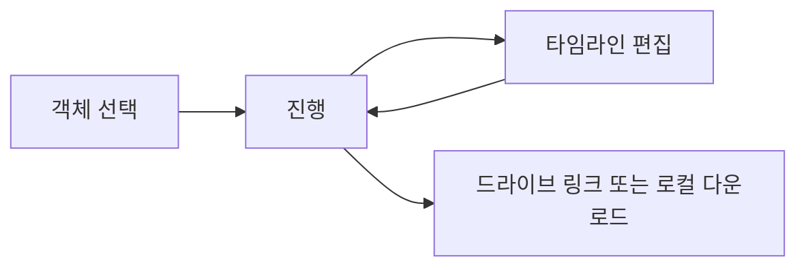

# 와이어프레임

세 화면이다. 객체 선택, 진행, 타임라인 편집. 너비는 데스크톱 기준이다.

## 객체 선택

```text
+------------------------------------------------------------------+
| Oxstract                          [객체 선택] [진행] [타임라인]   |
+------------------------------------------------------------------+
| 업로드 [파일 선택]                                                |
+------------------------------------------------------------------+
|                                                                  |
|   +----------------------------------------------------------+   |
|   |                      VideoPlayer                         |   |
|   |            +------------------+                          |   |
|   |            | BoxSelection     |  <- 드래그 또는 탐지 박스 |   |
|   |            +------------------+                          |   |
|   +----------------------------------------------------------+   |
|   |====================O----------------------|  00:12.4         |
|   [이 장면에서 선택]   방식: ( ) 드래그  ( ) 탐지 박스 클릭       |
+------------------------------------------------------------------+
| 움직임 임계값 [0.05]  최소 컷 [1.0초]  앞뒤 여유 [0.3초]          |
| [편집 시작]                                                       |
+------------------------------------------------------------------+
```

흐름: 재생 바로 장면을 고르고 "이 장면에서 선택"을 누른 뒤, 드래그하거나 탐지 박스를 클릭한다. 편집 시작이 `POST /jobs`다.

## 진행

```text
+------------------------------------------------------------------+
| Oxstract                          [객체 선택] [진행] [타임라인]   |
+------------------------------------------------------------------+
| 상태: 추적 중                                                     |
| [##########----------------------------]  42%                    |
| 단계 detect -> track -> segment -> render -> upload              |
|                                                                  |
| 완료되면 드라이브 링크와 로컬 다운로드를 여기에 보여 준다.         |
| 업로드가 실패하면 오류 문구와 로컬 다운로드만 남긴다.             |
+------------------------------------------------------------------+
```

진행 수치는 `WS /jobs/{id}/progress`다. 소켓이 없으면 문구로 알린다.

## 타임라인 편집

```text
+------------------------------------------------------------------+
| Oxstract                          [객체 선택] [진행] [타임라인]   |
+------------------------------------------------------------------+
| VideoPlayer (선택 구간 미리보기)                                  |
+------------------------------------------------------------------+
| Timeline                                                          |
| |--컷1--|fade|----컷2----|text|---컷3---|                        |
|  1.2-4.8      12.0-15.5         20.0-22.0                         |
| [선택 전환을 마지막 컷 제외 전체에 적용]                          |
+------------------------------------+-----------------------------+
| TransitionSettingsPanel            | 구간 추가 / 삭제 / 길이 조정 |
| 전환 [페이드 v]                    |                             |
| 길이 [0.5초]                       | [렌더]                      |
| 미리보기 자리                      |                             |
+------------------------------------+-----------------------------+
```

컷 사이를 고르면 설정 패널이 열린다. 마지막 컷 뒤에는 패널을 끈다. 저장은 `PATCH /jobs/{id}/segments`, 렌더는 `POST /jobs/{id}/render`다.


