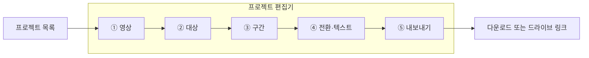

# 와이어프레임

2026-10-31 확정된 화면은 인터랙티브 목업으로 대신한다. 단계마다 한 화면씩, 클릭해서 써 볼 수 있다.

- 목업: [Oxstract UI 개편 목업](https://claude.ai/artifact/QcEmMAB1BkMQRtXEWGc9Dd) (소유자만 열 수 있다. 다른 사람과 보려면 목업 화면의 공유 메뉴에서 연다)
- 글로 된 설명과 ASCII 배치도: [ui-redesign.md](ui-redesign.md) 3장

## 화면 흐름

편집기는 한 화면이다. 위에 단계 표시, 왼쪽 클립 목록, 가운데 뷰어, 오른쪽 설정 패널, 아래 타임라인. 단계가 바뀌면 가운데와 오른쪽, 아래의 내용만 바뀐다. 조건이 안 된 단계는 잠긴 채 이유를 툴팁으로 보여 준다.
