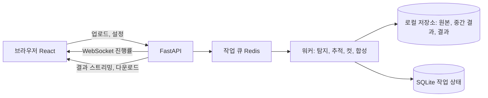

# 웹 기반 영상 편집 앱 구현 계획서

> 이 문서는 구현 담당 에이전트에게 전달하기 위한 계획서입니다. 구현 전 "6. 미결 사항"의 남은 항목을 요청자에게 먼저 확인하세요.

## 1. 개요

- **플랫폼**: 웹 기반 영상 편집 앱
- **배포**: 요청자 소유의 서버 컴퓨터에서 로컬로 실행 (해외 서버 아님. 처음 "외국 서버"라고 했다가 정정함)
- **핵심 기능**: 사용자가 지정한 객체를 영상에서 자동으로 탐지하고, 그 객체의 움직임을 추적해서, 객체가 움직이는 구간만 잘라낸 뒤, 그 컷들을 시간순으로 이어 붙여 하나의 결과 영상으로 만든다.

## 2. 사용자 흐름

1. 브라우저에서 로컬 서버 주소에 접속한다.
2. 영상을 업로드한다.
3. 대상 객체를 지정한다 (텍스트 입력 예: "강아지", 또는 첫 프레임에서 박스나 클릭으로 선택).
4. 민감도 옵션(움직임 임계값, 최소 컷 길이, 컷 앞뒤 여유 시간)을 조정한다.
5. 처리를 시작하고 진행률을 확인한다.
6. 탐지된 구간 타임라인을 미리 보고, 필요하면 구간을 추가, 삭제, 조정한다.
7. 최종 영상을 렌더링해서 다운로드한다.

## 3. 기술 스택 제안

| 영역 | 제안 | 비고 |
|---|---|---|
| 프론트엔드 | React + TypeScript + Vite | 타임라인 UI, 영상 미리보기 |
| 백엔드 API | Python FastAPI | ML 라이브러리와 같은 언어 |
| 작업 큐 | Celery 또는 RQ + Redis (단순하게는 FastAPI BackgroundTasks) | 긴 처리 작업 비동기화 |
| 객체 탐지 | Ultralytics YOLO (YOLOv8/11) | 클래스 기반 지정 |
| 텍스트로 객체 지정 | Grounding DINO 또는 YOLO-World | 임의 객체명 지원 |
| 클릭/박스로 지정 및 추적 | SAM 2 (비디오 모드) | 마스크 단위 정밀 추적 |
| 추적 | ByteTrack / BoT-SORT (Ultralytics 내장) | 객체 ID 유지 |
| 영상 처리 | FFmpeg, OpenCV, PyAV | 디코딩, 컷, 합치기 |
| 진행률 전달 | WebSocket 또는 SSE | |
| 저장소 | 로컬 파일 시스템 + SQLite | 작업 메타데이터 |
| 실행 환경 | Docker Compose, NVIDIA GPU 권장 (CUDA) | CPU 폴백 지원 |

## 4. 아키텍처



- 모든 구성 요소가 한 대의 서버 컴퓨터에서 실행되고, 같은 네트워크의 브라우저에서 접속한다.
- 주요 API
  - `POST /videos` 업로드
  - `GET /videos/{id}/frame?t=` 객체 선택용 프레임
  - `POST /jobs` (video_id, target, options) 처리 시작
  - `GET /jobs/{id}` 상태와 탐지 구간 목록
  - `PATCH /jobs/{id}/segments` 구간 수동 수정
  - `POST /jobs/{id}/render` 최종 합성
  - `GET /jobs/{id}/output` 결과 다운로드
  - `WS /jobs/{id}/progress`

## 5. 핵심 파이프라인

### 5.0 객체 선택 단계 (자동 편집 시작 전, 확정 요구사항)
1. 사용자가 영상에서 원하는 장면(프레임)을 아무거나 고른다 (재생 바 탐색 후 "이 장면에서 선택").
2. 그 장면에서 아래 두 가지 방법 중 하나로 대상 객체를 선택한다.
   - a. **드래그 선택**: 마우스로 객체 영역을 직접 드래그해 박스를 지정한다.
   - b. **탐지 모델 박스 클릭**: 해당 프레임에 객체 탐지 모델(YOLO 등)을 실행해 바운딩 박스들을 화면에 표시하고, 사용자가 원하는 박스를 클릭해 선택한다.
3. 객체 선택이 끝나면 자동 편집(5.1 추적, 5.2 움직임 구간 판정, 5.3 컷 추출, 5.4 합성)이 시작된다.
- API: `GET /videos/{id}/frame?t=` 프레임 이미지, `POST /videos/{id}/detect?t=` 해당 프레임 탐지 결과(박스 목록), `POST /jobs`에 `{frame_t, bbox, source: "drag" | "detect", class?}` 전달.
- 선택된 박스는 5.1의 추적 시작점(초기 박스)으로 사용하며, 선택한 프레임 기준으로 앞뒤 양방향으로 추적한다.

### 5.1 객체 탐지 및 추적
- 프레임 샘플링: 기본 원본 fps, 속도가 필요하면 N프레임마다 탐지하고 사이는 추적으로 보간.
- 지정 방식별 처리
  - 클래스명: YOLO 탐지 후 ByteTrack으로 ID 부여.
  - 자유 텍스트: Grounding DINO/YOLO-World로 첫 탐지 후 추적.
  - 클릭/박스: SAM 2 비디오 전파로 마스크 추적.
- 같은 클래스 객체가 여러 개일 때 어떤 ID를 따라갈지 정해야 함 (기본은 사용자가 선택한 하나, "6. 미결 사항" 참고).
- 출력: 프레임별 `{t, bbox 또는 mask, confidence, track_id}`.

### 5.2 움직임 구간 판정
- 프레임 간 객체 중심점 이동량을 bbox 대각선 길이로 정규화 (카메라 줌 영향 완화).
- 선택 사항: 카메라 자체 움직임 보정 (배경 광학 흐름으로 전역 움직임 추정 후 차감).
- 이동량을 이동 평균으로 스무딩한 뒤 임계값과 히스테리시스로 "움직임 중 / 정지" 상태 판정.
- 후처리
  - 짧은 정지 틈(예: 0.5초 미만)은 병합
  - 최소 구간 길이(예: 1초) 미만은 제거
  - 구간 앞뒤로 여유 시간(예: 0.3초) 추가
  - 객체가 화면에서 사라진 구간은 제외
- 출력: `[{start, end, score}]` 시간순 목록.

### 5.3 컷 추출
- FFmpeg로 구간별 클립 생성.
- 정확한 프레임 단위 컷을 위해 재인코딩을 기본으로 함 (`-ss`/`-to` + libx264, GPU가 있으면 NVENC). 빠른 모드는 키프레임 기준 스트림 복사.
- 오디오 포함 여부는 옵션.

### 5.4 컷 합성
- 클립을 시간순으로 정렬해 FFmpeg concat으로 하나의 영상으로 합친다.
- 해상도, fps, 코덱을 통일하고, 옵션으로 컷 사이 짧은 페이드 전환.
- 결과와 함께 구간 목록 JSON(원본 시각 기준)도 저장.

### 5.5 컷별 전환 옵션 (확정 요구사항)
- 각 컷과 다음 컷 사이에 사용자가 편집기 UI에서 컷마다 개별로 아래 중 하나를 선택한다.
  1. **페이드 인/페이드 아웃**: 앞 컷은 페이드 아웃, 다음 컷은 페이드 인 (FFmpeg `fade`/`afade` 또는 `xfade`). 길이 조절 가능 (기본 0.5초).
  2. **배경색 + 텍스트 장면 삽입**: 컷 사이에 단색 배경 위에 텍스트가 있는 장면을 넣는다. 배경색, 텍스트 내용, 글꼴 크기와 색, 표시 시간(기본 2초)을 설정 (FFmpeg `color` 소스 + `drawtext`, 한글 글꼴 포함).
  3. **효과 없음 (바로 전환)**: 다음 컷으로 곧바로 이어진다. 기본값.
- 데이터 모델: 구간마다 `transition_after: {type: "fade" | "text_card" | "none", duration, bg_color, text, font_size, font_color}`. 마지막 컷 뒤는 없음.
- UI: 타임라인의 컷 사이마다 전환 선택 드롭다운과 설정 패널, 미리보기 제공. 전체 컷 일괄 적용 버튼.
- API: `PATCH /jobs/{id}/segments`에 전환 설정 포함.
- 합성(5.4) 시 전환이 있는 경우 concat 대신 필터 그래프로 렌더링하고, 텍스트 장면 클립은 결과 영상과 같은 해상도, fps, 코덱으로 생성.

### 5.6 구글 드라이브 업로드 및 완료 알림 (확정 요구사항)
- 영상 편집(최종 렌더링)이 끝나면 결과 파일을 구글 드라이브에 업로드하고, 사용자에게 그 파일 링크를 알려준다.
  - 웹 앱 작업 화면에 완료 알림과 드라이브 링크(`webViewLink`)를 표시한다.
  - 업로드 폴더는 설정 파일의 `folder_id`로 지정한다. 없으면 루트에 저장한다.
- 구현: Google Drive API v3 + Python 클라이언트 라이브러리 `google-api-python-client` (인증은 `google-auth-oauthlib`). 큰 파일은 `MediaFileUpload(resumable=True)`로 이어받기 업로드.
- OAuth 흐름: 처음 한 번 브라우저에서 구글 계정 승인을 거쳐 refresh token을 발급받고, 이후에는 저장된 토큰으로 자동 갱신한다. 권한 범위는 앱이 만든 파일만 다루는 `drive.file`을 권장한다.
- 업로드 실패 시 결과 파일은 로컬에 그대로 두고, 화면에 오류와 로컬 다운로드 링크를 표시한다.

## 6. 미결 사항 (구현 전 요청자에게 확인 필요)

1. ~~컷마다 추가로 할 처리~~: 확정됨. "5.5 컷별 전환 옵션" 참고.
2. 객체 지정 방식: 텍스트, 클래스 선택, 화면 클릭 중 어떤 방식이 필요한가.
3. 같은 종류 객체가 여러 개일 때 하나만 따라갈지, 전부 대상으로 할지.
4. "움직임"의 기준: 화면 안 위치 이동인지, 자세 변화(제자리 동작)도 포함인지.
5. 입력 영상의 일반적인 길이, 해상도, 형식과 서버 GPU 사양.
6. 결과물 형식(mp4/H.264 등)과 오디오 유지 여부.
7. 여러 사용자가 동시에 쓰는지, 로그인이 필요한지.

## 7. 마일스톤

1. **M1 기반 구성**: 프로젝트 구조, Docker Compose, 업로드, 저장, 영상 재생.
2. **M2 탐지 및 추적 PoC**: CLI로 영상과 클래스명을 넣으면 프레임별 추적 결과 JSON과 디버그 영상 출력.
3. **M3 움직임 구간 판정**: 구간 목록 생성, 파라미터 튜닝, 샘플 영상으로 검증.
4. **M4 컷 및 합성**: FFmpeg 컷, 시간순 합치기, 결과 영상 출력 (CLI 기준 전체 파이프라인 완성).
5. **M5 웹 연동**: 작업 큐, 진행률, 객체 선택 UI, 구간 타임라인 미리보기 및 수정.
6. **M6 컷별 전환**: 5.5의 세 가지 전환 옵션(페이드, 배경색 텍스트 장면, 효과 없음)과 컷별 설정 UI 구현.
7. **M7 마무리**: 오류 처리, 긴 영상 성능 최적화, 임시 파일 정리, 사용 문서.

## 8. 완료 기준

- 로컬 서버에서 실행한 웹 앱으로 영상을 올리고 객체를 지정하면, 그 객체가 움직이는 구간만 시간순으로 이어진 결과 영상을 다운로드할 수 있다.
- 탐지된 구간을 화면에서 확인하고 수정할 수 있다.
- 편집이 끝나면 결과 파일이 구글 드라이브에 업로드되고, 그 링크가 사용자에게 표시된다.
- 컷 사이마다 페이드, 배경색 텍스트 장면, 효과 없음 중 하나를 선택할 수 있고 결과 영상에 반영된다.

## 9. 설정 및 배포 (인증 정보와 설정 파일)

### 필요한 구글 드라이브 인증 정보
| 항목 | 설명 |
|---|---|
| API ID (API 키) | Google Cloud 콘솔에서 Drive API를 활성화한 프로젝트의 API 키 |
| OAuth 클라이언트 ID | 같은 프로젝트에서 만든 OAuth 클라이언트 ID (데스크톱 앱 유형 권장) |

- 요청자 경험상 위 두 가지면 충분했다고 함. 다만 구현 담당은 OAuth 흐름에서 클라이언트 보안 비밀(`client_secret`)이 함께 필요한지 확인하고, 필요하면 같은 방식으로 보관한다.
- 최초 승인 후 받은 refresh token도 민감 정보로 취급한다.

### 설정 파일 (`config/drive.yaml`)
```yaml
google_drive:
  enabled: true
  api_key: ""            # API ID
  oauth_client_id: ""    # OAuth 클라이언트 ID
  token_path: config/drive_token.json   # 최초 승인 후 자동 생성
  folder_id: ""          # 업로드할 드라이브 폴더 (선택)
```

- `config/drive.yaml`과 `config/drive_token.json`은 `.gitignore`에 추가해 버전 관리에서 제외하고, 저장소에는 값이 빈 `config/drive.example.yaml`만 커밋한다. 서버에서는 소유자만 읽도록(`chmod 600`) 권한을 설정한다.
- Docker Compose에서는 `config/`를 볼륨으로 마운트한다.

## 10. 예상 부하 및 성능 참고

- 근거: Ultralytics 공식 YOLO11 벤치마크 (640px 입력, 프레임당). CPU(ONNX)는 n 56ms, s 90ms, m 183ms. T4 GPU(TensorRT)는 n 1.5ms, s 2.5ms, m 4.7ms.
- 10분 1080p 30fps 영상(약 18,000프레임) 기준 탐지 및 추적 시간
  - CPU만 사용: nano 약 17분, small 약 27분, medium 약 55분.
  - CPU + 2~3프레임마다 탐지(사이는 추적으로 보간): nano 약 6~8분.
  - RTX 3060/4060급 GPU: 약 2~5분 (디코딩과 전처리가 병목, 실측 아닌 추정치).
- 권장 사양: GPU 메모리 4GB 이상(nano~medium), 시스템 메모리 16GB 권장. 결과 재인코딩에 수 분 추가될 수 있으며 NVENC로 단축 가능.
- 부하 절감: 프레임 샘플링(2~3프레임 간격), 640px 입력 유지, nano/small 모델로 시작해 정확도가 부족할 때만 medium으로 상향.
- 서버 실제 사양은 미확인. 구현 담당은 GPU 모델과 메모리를 확인해 모델 크기와 샘플링 간격을 정한다.
